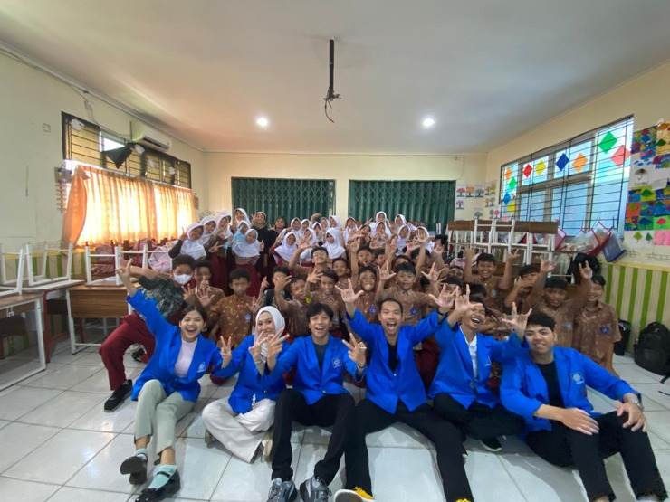
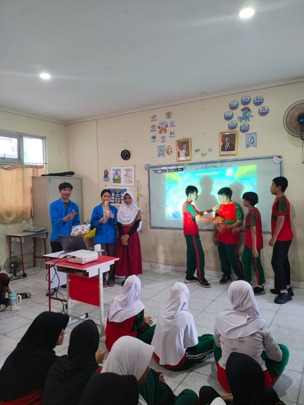
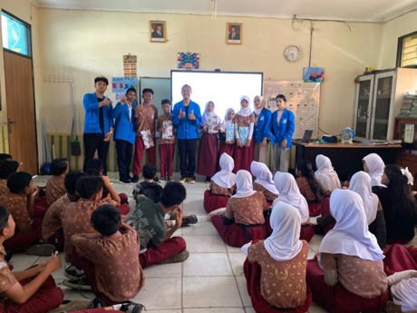
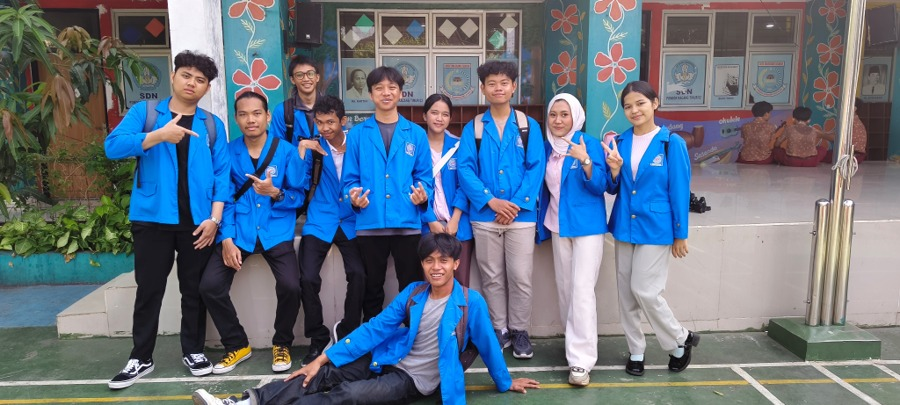

# Mahasiswa Semester 3 UBSI Gelar Pelatihan Teknologi untuk Siswa SDN Pondok Kacang Timur 02, Seru dengan Games Edukatif!

> **Berita Kampus • PKM Character Building**
>
> Selasa, 3 November 2026 | Oleh Tim Pelaksana PKM Mahasiswa Semester 3 Sistem Informasi UBSI

*Suasana foto bersama mahasiswa semester 3 Program Studi Sistem Informasi UBSI dan siswa SDN Pondok Kacang Timur 02 usai kegiatan.*

Sepuluh mahasiswa semester 3 Program Studi Sistem Informasi (S1) Universitas Bina Sarana Informatika (UBSI) menggelar kegiatan Pengabdian kepada Masyarakat (PkM) mata kuliah *Character Building* di SDN Pondok Kacang Timur 02, Tangerang Selatan. Kegiatan berjudul "Pelatihan Mengembangkan Potensi Diri Melalui Teknologi" ini mengusung slogan *"Belajar, Berinovasi, Meraih Masa Depan Lebih Baik"* dan dilaksanakan secara tatap muka.

Kegiatan berlangsung pada Selasa, 3 November 2026, pukul 07.30–09.30 WIB, diikuti 97 siswa kelas 6A, 6B, 6C, dan 6D. Sekolah mitra yang berdiri sejak 10 Oktober 1976 ini terakreditasi A dan dikenal aktif mengembangkan kreativitas siswa melalui program Market Day, ekstrakurikuler menari, serta Projek Penguatan Profil Pelajar Pancasila (P5). Materi yang disampaikan berfokus pada pemanfaatan teknologi secara kreatif, aman, dan bertanggung jawab untuk mengembangkan potensi diri.

> "Melalui kegiatan ini, kami ingin membantu siswa memahami bahwa teknologi bukan sekadar hiburan, tetapi juga sarana belajar untuk mengenali potensi diri dan berinovasi secara bijak,"
>
> — **M. Andika Farhansyah**, Ketua Pelaksana

Penyampaian materi dipadukan dengan sesi tanya jawab interaktif untuk mengukur pemahaman sekaligus menumbuhkan keberanian siswa. Rangkaian acara dilanjutkan dengan permainan edukatif singkat yang melatih kerja sama dan kepercayaan diri, serta pemberian hadiah apresiasi berupa alat tulis dan perlengkapan belajar kepada siswa yang berpartisipasi aktif.

| Sesi edukasi & permainan | Penyerahan hadiah |
| :---: | :---: |
|  |  |
| Sesi edukasi dan permainan interaktif di depan kelas. | Penyerahan bingkisan apresiasi kepada siswa yang aktif berpartisipasi. |

### Tim Pelaksana

1. **M. Andika Farhansyah** (NIM: 19250604) – Ketua Pelaksana dan Koordinator Kegiatan *(Kontak: 19250604@bsi.ac.id)*
2. **Muhammad Hafizh Ramadhan** (NIM: 19251193) – Wakil Ketua Pelaksana dan Koordinator Lapangan
3. **Adi Hermawandi** (NIM: 19250225) – Tim Pelaksana / Pemateri
4. **Rafli Hera Sumadi** (NIM: 19250069) – Tim Pelaksana / Pemateri
5. **Sahira Nazara Putri Kayla** (NIM: 19252335) – Tim Pelaksana / Pemateri
6. **Muhammad Iyas Arkan** (NIM: 19252261) – Tim Pelaksana / Pemateri
7. **Rasyiid Nur Rizqi** (NIM: 19250637) – Tim Pelaksana / Pemateri
8. **Mico Kurniawan** (NIM: 19251446) – Tim Pelaksana / Pemateri
9. **Julita Manalu** (NIM: 19252543) – Tim Pelaksana / Pemateri
10. **Wulan Sitompul** (NIM: 19251461) – Tim Pelaksana / Pemateri

*Sepuluh mahasiswa semester 3 Program Studi Sistem Informasi (S1) UBSI selaku tim pelaksana kegiatan.*

Kolaborasi antara mahasiswa UBSI dan pihak sekolah menunjukkan bahwa teknologi dapat menjadi jembatan pembelajaran yang menyenangkan. Seluruh 97 siswa mengikuti rangkaian acara dengan antusiasme tinggi, aktif merespons pertanyaan pemateri, dan berpartisipasi penuh dalam permainan edukatif hingga kegiatan ditutup pada pukul 09.30 WIB.

---

`Universitas Bina Sarana Informatika` `UBSI` `Sistem Informasi` `Character Building` `Pengabdian Masyarakat` `SDN Pondok Kacang Timur 02`
